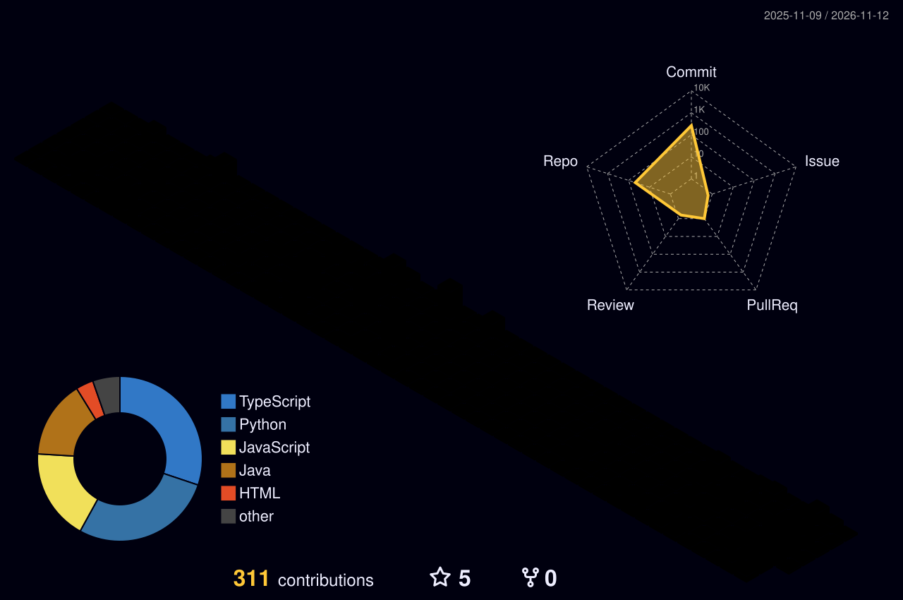

 

### `00` &nbsp;Signal

I'm Adithya, a third-year B.Tech student in Artificial Intelligence & Data Science at KL University, and I build AI products end to end. Most of my work sits where models meet real users: LLM agents, retrieval, voice interfaces in Indian languages, and computer vision, plus the FastAPI, React and Android code that turns them into something people can actually use.

What I care about most is the part demos skip: validating inputs, putting deterministic rules around model output, keeping an audit trail, and writing the tests. Hackathons are where many of these projects started, and seven of them ended on the podium.

 

### `01` &nbsp;The pattern I keep building

In my projects the model is rarely the final authority. It observes or proposes, and a layer I can test decides what actually happens.

<table>
<tr>
<td width="20%" valign="top"><b>CUBE Returns Manager</b> A vision model observes</td>
<td width="20%" valign="top"><b>Vaani</b> An LLM plans</td>
<td width="20%" valign="top"><b>RecoverAI</b> A fine-tuned LLM recommends</td>
<td width="20%" valign="top"><b>TrustLayer</b> A classifier tags PII</td>
<td width="20%" valign="top"><b>RESOLVE</b> Memory recalls past fixes</td>
</tr>
<tr>
<td valign="top">→ a deterministic rules engine decides the disposition</td>
<td valign="top">→ the laptop agent runs only allowlisted actions</td>
<td valign="top">→ a policy layer authorizes before anything executes</td>
<td valign="top">→ role policies enforced in the backend, every decision audited</td>
<td valign="top">→ verification checks whether the fix stayed fixed</td>
</tr>
</table>

 

### `02` &nbsp;Selected builds

<table>
<tr>
<td width="50%" valign="top">

#### [RESOLVE](https://github.com/Adithya-charan/ResolveAi)
**Incident response that remembers.** When a new incident lands, RESOLVE pulls up similar past incidents with their root causes, the fixes that failed, the fix that worked, and whether it held.

Hindsight agent memory handles recall, PostgreSQL keeps the structured history, and an LLM reasons over both.

`Next.js` `TypeScript` `FastAPI` `PostgreSQL (Neon)` `Hindsight` `Groq`

</td>
<td width="50%" valign="top">

#### [CUBE Returns Manager](https://github.com/Adithya-charan/cube-04-returns-manager)
**Inspecting returned products with evidence.** From photos of a return, it checks identity, completeness and condition, then decides restock, refurbish, liquidate or human review.

Qwen3-VL only reports what it sees. A tested Python rules engine makes the call, and anything uncertain goes to a person.

`YOLOv8` `Qwen3-VL (Ollama)` `FastAPI` `React` `SQLite` `pytest`

</td>
</tr>
<tr>
<td width="50%" valign="top">

#### [Vaani](https://github.com/Adithya-charan/Vaani)
**Control your laptop by talking to your phone.** Speak or type a command on Android in English, Hindi, Telugu or a mix, and a Windows laptop carries it out and answers back.

The AI proposes a plan, but the laptop agent runs only a short allowlist of actions, over a private Tailscale link.

`Kotlin` `Jetpack Compose` `Python` `FastAPI` `Groq` `Sarvam AI`

</td>
<td width="50%" valign="top">

#### [Memora](https://github.com/Adithya-charan/memora)
**Ask questions about your own photos and documents.** Find the warranty card, the invoice or that one screenshot, with every answer pointing back to its source files.

Fully local: Gemma models through Ollama, hybrid embedding and FTS5 keyword search in SQLite, and a native Android app over Wi-Fi.

`Python` `FastAPI` `Ollama` `SQLite FTS5` `Kotlin` `Jetpack Compose`

</td>
</tr>
<tr>
<td width="50%" valign="top">

#### [TrustLayer](https://github.com/Adithya-charan/Trustlayer)
**Showing each person only the data their role needs.** Built for banking and finance: it finds sensitive columns and masks query results by role without changing the stored data.

Rule + ML PII detection, policies enforced in the backend, an audit trail of every decision, and a multilingual voice assistant that answers from that trail.

`FastAPI` `SQLAlchemy` `PostgreSQL` `React` `LiveKit` `n8n`

</td>
<td width="50%" valign="top">

#### [RecoverAI](https://github.com/Adithya-charan/Recover-Ai)
**Winning back revenue that's slipping away.** Spots failed payments, abandoned checkouts and overdue receivables, then plans how to recover each one.

An ML model predicts the chance of recovery, a LoRA fine-tuned Qwen2.5 recommends the action, and a policy layer approves it before anything runs.

`Python` `FastAPI` `scikit-learn` `Transformers + PEFT` `Razorpay` `React`

</td>
</tr>
</table>

<b>Also built:</b>
<a href="https://github.com/Adithya-charan/janavani">JanaVani</a> (multilingual civic issue reporting) ·
<a href="https://github.com/Adithya-charan/SupportIQ">SupportIQ</a> (autonomous customer support with voice) ·
<a href="https://github.com/Adithya-charan/shopsahayak">ShopSahayak</a> (ask your shop's data by voice) ·
<a href="https://github.com/Adithya-charan/SwasthyaSetu">SwasthyaSetu</a> (multilingual telemedicine) ·
<a href="https://github.com/Adithya-charan/Chiefos">ChiefOS</a> (AI chief of staff) ·
<a href="https://github.com/Adithya-charan/VyaparSetu">Vyapara Setu</a> (business formalization for entrepreneurs)

  

### `03` &nbsp;Stack

<table>
<tr>
<td width="22%"><b>Languages</b></td>
<td>

</td>
</tr>
<tr>
<td><b>AI & ML</b></td>
<td>

</td>
</tr>
<tr>
<td><b>LLMs & Voice</b></td>
<td>

</td>
</tr>
<tr>
<td><b>Backend</b></td>
<td>

</td>
</tr>
<tr>
<td><b>Frontend & Mobile</b></td>
<td>

</td>
</tr>
<tr>
<td><b>Data</b></td>
<td>

</td>
</tr>
<tr>
<td><b>Tooling & Deploy</b></td>
<td>

</td>
</tr>
</table>

 

### `04` &nbsp;On the podium

Seven hackathons and fests, seven podium finishes, from IIT Delhi to IISc Bengaluru.

<table>
<tr><th align="left">Event</th><th align="left">Result</th><th align="left">Where · When</th></tr>
<tr><td>Square Hacks, Students Change Initiatives Festival</td><td><b>Best Design</b> · top 30 of 600+ teams</td><td>IIT Delhi · Dec 2025</td></tr>
<tr><td>Systems for Machine Learning 2.0 (SysML 2.0)</td><td><b>Winner</b> · federated learning for edge devices</td><td>IISc Bengaluru, ACM Student Chapter</td></tr>
<tr><td>National Student Change Initiatives Fest 2026</td><td><b>Winner</b> · pitch deck</td><td>Delhi · Mar 2026</td></tr>
<tr><td>NASA International Space Apps Challenge 2025</td><td><b>Best Use of Science</b></td><td>VIT-AP University · Oct 2025</td></tr>
<tr><td>SustainX · SDGs to Startups</td><td><b>Winner</b></td><td>VIT-AP University · 2026</td></tr>
<tr><td>Code Fusion 2026</td><td><b>2nd Place</b></td><td>VR Siddhartha, Vijayawada · Jan 2026</td></tr>
<tr><td>D³ Rewind & Recode, national finale</td><td><b>4th Prize</b> · AI-powered lecture generator</td><td>IIT Bhubaneswar</td></tr>
</table>

Photos, certificates and write-ups for each event are on my <a href="https://adithyacharanin.vercel.app/#hackathons">portfolio</a>.

  

### `05` &nbsp;Roles

<table>
<tr><td width="34%"><b>Technical Lead</b> KL-VEDA, KL University · Nov 2025 – present</td><td>Lead a 10+ member team building campus web apps. I own the architecture, sprint planning and code reviews.</td></tr>
<tr><td><b>Member, Web & Software Development</b> Websico · Sep 2025 – present</td><td>Build responsive full-stack apps with React, Node.js and Express.</td></tr>
<tr><td><b>Student Member</b> IEEE Consumer Technology Society · 2026</td><td>Professional membership.</td></tr>
</table>

 

### `06` &nbsp;Activity

Rebuilt every night by a GitHub Action from my real contribution data. The live record is my <a href="https://github.com/Adithya-charan">contribution graph</a>.

 

### `07` &nbsp;Current direction

- **Voice AI in Indian languages:** speech interfaces that work in Telugu, Hindi and English, so people can use software in the language they think in
- **Agents with guardrails:** LLM planners paired with deterministic checks, policies and audit trails
- **Retrieval and memory:** grounded answers that cite their sources, and systems that learn from past outcomes
- **Local-first models:** running open models on my own hardware with Ollama, so private data stays private

 

### `08` &nbsp;Connect

Open to AI engineering roles, internships and research collaborations. Email is the fastest way to reach me.

[Portfolio](https://adithyacharanin.vercel.app/) &nbsp;·&nbsp;
[LinkedIn](https://www.linkedin.com/in/adithya-charan-6b7bb138b/) &nbsp;·&nbsp;
[Email](mailto:adityayaramalla@gmail.com) &nbsp;·&nbsp;
[Résumé](https://adithyacharanin.vercel.app/assets/resume/Adithya_Charan_Resume.pdf) &nbsp;·&nbsp;
[Unstop](https://unstop.com/u/yadi80725)

 

